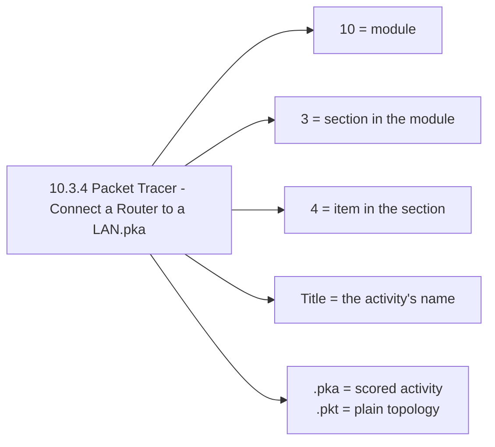
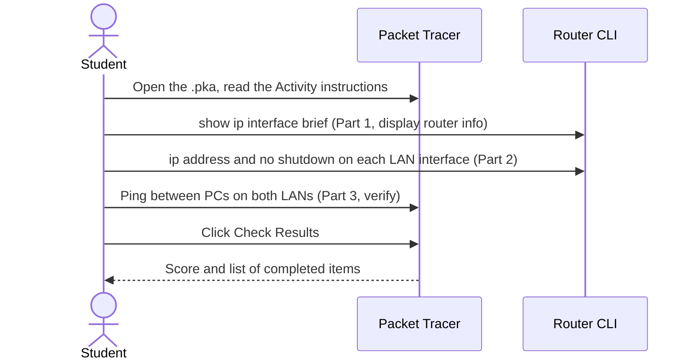

# All Networking Basics With Labs (Cisco Packet Tracer)

A collection of **30 Cisco Packet Tracer practice files** that follow an introductory networking course: from reading a network diagram and navigating the Cisco IOS command line, through switches, routers, IPv4 and IPv6 addressing, subnetting and VLSM, ICMP and transport protocols, to securing devices and troubleshooting a small network. Each file is a self-contained hands-on activity you open in Packet Tracer.

The file numbering (`4.7.1`, `10.3.4`, `17.8.2`, ...) follows the module and section numbers of Cisco's CCNA *Introduction to Networks* course.

---

## Table of contents

1. [What it covers](#what-it-covers)
2. [Technology](#technology)
3. [Learning path](#learning-path)
4. [File naming](#file-naming)
5. [Lab index](#lab-index)
6. [Project structure](#project-structure)
7. [How to open and use the files](#how-to-open-and-use-the-files)
8. [Walkthrough: a typical lab](#walkthrough-a-typical-lab)
9. [Notes on the files](#notes-on-the-files)
10. [Limitations and next steps](#limitations-and-next-steps)

---

## What it covers

| Area | Labs | Skills practised |
|---|---|---|
| Networking today | 1.5.7 | Reading a realistic business network: routers, switches, wireless, servers, cloud |
| IOS and switch basics | 2.3.7, 2.5.5, 2.7.6, 2.8.1, 2.8.2, 2.9.1 | CLI modes, hostnames, banners, saving configs, management IPs, end-to-end connectivity |
| Protocols and models | 3.5.5 | HTTP traffic in Simulation mode, TCP/IP and OSI layers |
| Physical layer | 4.6.5, 4.7.1 | Choosing modules and cables, wired and wireless connections |
| Router basics | 10.1.4, 10.3.4, 10.3.5, 10.4.3 | Initial router settings, router interfaces on a LAN, default gateway faults |
| IPv4 addressing | 11.5.5, 11.7.5, 11.9.3, 11.10.1 | Subnetting and VLSM design, then implementing it |
| IPv6 addressing | 12.6.6, 12.9.1 | IPv6 addresses on routers, servers and clients, IPv6 subnetting |
| ICMP and testing | 13.2.6, 13.2.7, 13.3.1 | Ping, traceroute, locating and fixing connectivity problems |
| Transport layer | 14.8.1 | TCP and UDP behaviour in Simulation mode |
| Security | 16.4.6, 16.5.1 | Secure passwords, SSH, hardening switches and routers |
| Build and troubleshoot | 17.5.9, 17.7.7, 17.8.2, 17.8.3 | Reading `show` output, troubleshooting, skills challenges |

| Technology | Role |
|---|---|
| Cisco Packet Tracer 8.x | Simulator used to open and run every file |
| Cisco IOS CLI | Device configuration |
| Cisco 1941, 2911, 2811, ISR4321 routers | Routing labs |
| Cisco 2960 and 3650/3560 switches | Switching and VLSM labs |
| IPv4, IPv6, ICMP, TCP, UDP, HTTP | Protocols examined |
| SSH, passwords, banners | Device security labs |

---

## Learning path

The labs are meant to be taken in numeric order, because later ones assume the commands from earlier ones.

```mermaid
flowchart LR
    A["1 Networking basics<br/>1.5.7"] --> B["2 IOS and switches<br/>2.3.7 to 2.9.1"]
    B --> C["3 Protocol models<br/>3.5.5"]
    C --> D["4 Physical layer<br/>4.6.5, 4.7.1"]
    D --> E["10 Routers<br/>10.1.4 to 10.4.3"]
    E --> F["11 IPv4 and VLSM<br/>11.5.5 to 11.10.1"]
    F --> G["12 IPv6<br/>12.6.6, 12.9.1"]
    G --> H["13 ICMP<br/>13.2.6 to 13.3.1"]
    H --> I["14 TCP and UDP<br/>14.8.1"]
    I --> J["16 Security<br/>16.4.6, 16.5.1"]
    J --> K["17 Build a network<br/>17.5.9 to 17.8.3"]
```



There are no labs here for modules 5 to 9 or module 15.

---

## File naming



- **28 files are `.pka`** (Packet Tracer activity). They contain the instructions and the built-in scoring, so you can click **Check Results** inside Packet Tracer.
- **2 files are `.pkt`** (plain topology): the two *Video Activity* files in module 2.

---

## Lab index

"Starting topology" is what each file contains when it is first opened.

| # | Lab | Starting topology | What you do |
|---|---|---|---|
| 1.5.7 | Network Representation | 34 devices: 3 routers, 7 switches, wireless, cable modem, clouds, servers, PCs, phones | Explore a business network and answer questions |
| 2.3.7 | Navigate the IOS | 1 switch, 1 PC | Connect, use EXEC modes, set the clock |
| 2.5.5 | Configure Initial Switch Settings | 2 switches, 2 PCs | Check defaults, basic config, MOTD banner, save to NVRAM, configure the second switch |
| 2.7.6 | Implement Basic Connectivity | 2 switches, 2 PCs | Configure both switches, the PCs and a management interface |
| 2.8.1 | Video Activity - Test the Interface Assignment | 2 switches, 2 PCs | Companion topology for a course video (`.pkt`) |
| 2.8.2 | Video Activity - Test End-to-End Connectivity | 2 switches, 2 PCs | Companion topology for a course video (`.pkt`) |
| 2.9.1 | Basic Switch and End Device Configuration | 2 switches, 2 PCs | Hostnames, IPs, restrict access, save, verify connectivity |
| 3.5.5 | Investigate the TCP-IP and OSI Models in Action | 1 PC, 1 server | Watch HTTP traffic in Simulation mode and inspect TCP/IP elements |
| 4.6.5 | Connect a Wired and Wireless LAN | 11 devices, no cables yet (Linksys router, cable modem, cloud, 1841, 2621XM, server, printer, PCs) | Connect to the cloud, the router, remaining devices, verify |
| 4.7.1 | Connect the Physical Layer | 23 devices: two 1941 routers, switches, PCs, wireless, cell tower, central office | Identify physical characteristics, choose modules, connect, check |
| 10.1.4 | Configure Initial Router Settings | 1 router (1941), 1 PC | Verify defaults, configure, save |
| 10.3.4 | Connect a Router to a LAN | 2 routers, 4 switches, 4 PCs | Display router information, configure interfaces, verify |
| 10.3.5 | Troubleshoot Default Gateway Issues | 1 router, 2 switches, 4 PCs | Find and fix gateway faults from the documentation |
| 10.4.3 | Basic Device Configuration | 1 router, 2 multilayer switches (3650), 4 PCs | Complete documentation, configure router and switch, verify |
| 11.5.5 | Subnet an IPv4 Network | 2 routers, 3 switches, 3 PCs, 1 server | Design a subnet scheme, configure, test |
| 11.7.5 | Subnetting Scenario | 2 routers, 4 switches, 4 PCs | Design an addressing scheme, assign it, verify |
| 11.9.3 | VLSM Design and Implementation Practice | 2 routers, 4 switches, 4 PCs | Examine requirements, design VLSM, assign, verify |
| 11.10.1 | Design and Implement a VLSM Addressing Scheme | 2 routers, 4 switches, 4 PCs | Design VLSM, configure addressing, verify, troubleshoot |
| 12.6.6 | Configure IPv6 Addressing | 2 routers (2911, 2811), 2 switches, 2 PCs, 2 laptops, 2 servers | Router, server and client IPv6, then test |
| 12.9.1 | Implement a Subnetted IPv6 Addressing Scheme | 2 routers, 4 switches, 4 PCs | Plan IPv6 subnets, configure routers and PCs, verify |
| 13.2.6 | Verify IPv4 and IPv6 Addressing | 3 routers, 2 switches, 2 PCs | Fill in the addressing table, ping, traceroute |
| 13.2.7 | Use Ping and Traceroute to Test Network Connectivity | 3 routers, 4 switches, 4 PCs | Restore IPv4 and IPv6 connectivity |
| 13.3.1 | Use ICMP to Test and Correct Network Connectivity | 4 routers (3 x ISR4321, 1941), 5 switches, 4 PCs, 3 laptops, 2 servers | Locate and correct faults with ICMP |
| 14.8.1 | TCP and UDP Communications | 1 switch, 4 PCs, 1 server | Generate traffic in Simulation mode and compare TCP with UDP |
| 16.4.6 | Configure Secure Passwords and SSH | 1 router, 1 switch, 1 PC | Secure passwords and enable SSH |
| 16.5.1 | Secure Network Devices | 1 router (ISR4321), 2 switches, 2 PCs, 1 laptop | Harden network devices |
| 17.5.9 | Interpret show Command Output | 2 routers, 1 switch, 1 PC, 1 server | Analyse `show` output, answer reflection questions |
| 17.7.7 | Troubleshoot Connectivity Issues | 2 routers, 3 switches, 4 PCs, 3 servers | Fix issues or document them for escalation |
| 17.8.2 | Skills Integration Challenge | 3 routers (2911, 2 x 1941), 4 switches, 3 PCs, 3 servers | Combined configuration challenge |
| 17.8.3 | Troubleshooting Challenge | 3 routers, 4 switches, 3 PCs, 2 servers | Troubleshoot common LAN issues |

---

## Project structure

```
All-Networking-Basics-With-Labs/
├── 1.5.7  Packet Tracer - Network Representation.pka
├── 2.3.7  Packet Tracer - Navigate the IOS.pka
├── 2.5.5  ...
├── 2.8.1  Video Activity - Test the Interface Assignment.pkt
├── 2.8.2  Video Activity - Test End-to-End Connectivity.pkt
├── ...
└── 17.8.3 Packet Tracer - Troubleshooting Challenge.pka
```

All 30 files sit in the repository root (about 14 MB in total). There is no code, only Packet Tracer files.

---

## How to open and use the files

1. Install **Cisco Packet Tracer** (version 8.0 or newer; the newest files were saved with 8.0.0). It is free with a Cisco Networking Academy account.
2. Double-click a `.pka` or `.pkt` file, or use **File > Open**.
3. For a `.pka`, an **Activity** window opens with the instructions. Click **Check Results** to see your score.
4. Click a router or switch and use its **CLI** tab, or click a PC and use **Desktop** (IP Configuration, Command Prompt, Web Browser).
5. Save your own copy with **File > Save As** if you want to keep the original untouched.

---

## Walkthrough: a typical lab

Using **10.3.4 Connect a Router to a LAN** as the example:



---

## Notes on the files

- The activity text and scoring in these files originate from **Cisco Networking Academy** course material and remain Cisco's. They are shared here for study and practice.
- Each `.pka` stores several snapshots of its network. In labs where the task is cabling, a later snapshot contains more links than the one that opens first (for example 4.7.1 has 4 links initially and 19 in a later snapshot), so the files appear to carry a finished state as well as the starting one.
- The file versions range from Packet Tracer 7.2.1 to 8.0.0, so use a recent Packet Tracer to open them all.

---

## Limitations and next steps

- **No solutions guide.** There are no write-ups, screenshots or command lists, only the Packet Tracer files.
- **Partial coverage.** Modules 5 to 9 and 15 of the course have no lab file here.
- **No licence.** Add a licence and an attribution line for Cisco Networking Academy, or make the repository private.
- **Large binary files.** Packet Tracer files diff poorly in Git. Consider Git LFS or releases if the collection grows.

Ideas for next steps: add a short solution log per lab (the commands you typed), screenshots of the finished topologies, and a table of the IP plans you designed for the subnetting and VLSM labs.
